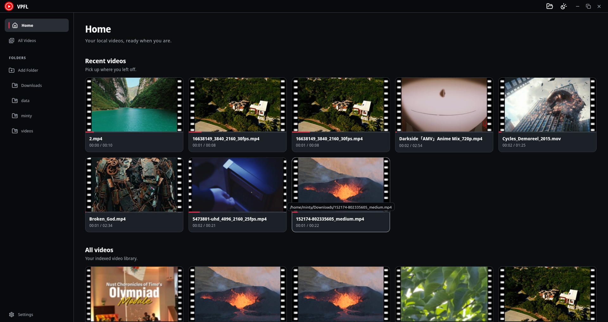
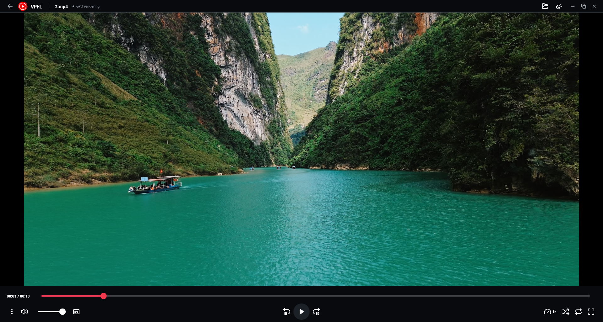
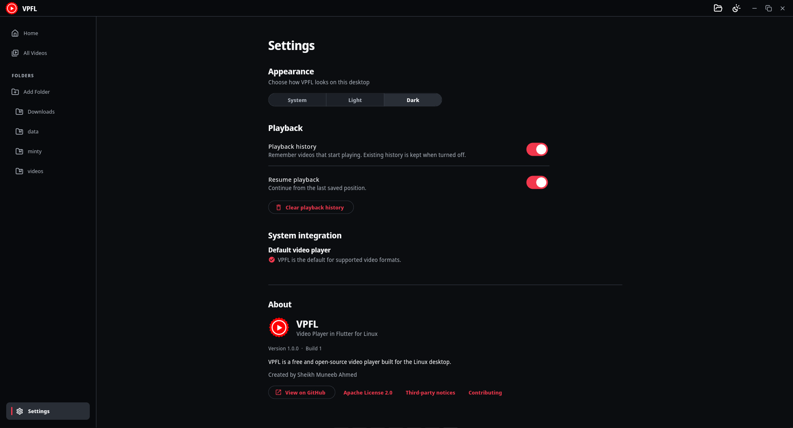

[](https://vpfl.openrepos.org/)

VPFL (Video Player in Flutter for Linux) is a free, open source video player for Linux that brings together smooth playback, powerful subtitle support, and a personal video library in a clean, modern desktop experience.

## Screenshots

**Home — Browse recent videos and folders.**



**Player — Watch videos with playback controls.**



**Settings — Customize playback and library preferences.**



## Features

- **Local video playback**: Play, pause, seek, change speed and volume, mute,
  choose a video fit, and watch in fullscreen.
- **Queue controls**: Move between videos, shuffle the queue, and repeat the
  current video or the whole queue.
- **Subtitles and tracks**: Select embedded subtitles or load external SRT,
  ASS, SSA, and WebVTT files. Adjust subtitle timing and choose available audio
  or video tracks.
- **Video library**: Add folders for indexing, browse their videos in one
  library, and return to recently played files.
- **Playback history and resume**: Continue unfinished videos from their saved
  positions. Control history and resume separately, or clear saved history.
- **Screenshots and details**: Save a frame as an image and inspect media
  information and playback diagnostics.
- **Linux desktop integration**: Open files from the desktop or command line,
  and set VPFL as the default app for its registered video formats.
- **Appearance and keyboard control**: Follow the system theme or choose light
  or dark mode, and use keyboard shortcuts for common player actions.
- **GPU presentation where available**: Present video through GPU rendering
  with a software fallback. Rendering mode is separate from video decoding.
- **Open source**: Use, inspect, modify, and redistribute VPFL under the
  Apache License 2.0.

## Supported video and subtitle formats

VPFL accepts these local video files and external subtitle files. Playback
depends on the codecs available through the installed mpv libraries.

| Type | Format | File extensions |
| --- | --- | --- |
| Video | MP4 / M4V / QuickTime | `.mp4`, `.m4v`, `.mov` |
| Video | Matroska / WebM | `.mkv`, `.webm` |
| Video | AVI / FLV / Ogg video | `.avi`, `.flv`, `.ogv` |
| Video | MPEG video / DVD video | `.mpeg`, `.mpg`, `.vob` |
| Video | MPEG transport stream | `.ts`, `.mts`, `.m2ts` |
| Video | Windows Media / ASF | `.wmv`, `.asf` |
| Video | 3GPP / 3GPP2 | `.3gp`, `.3g2` |
| Video | MXF | `.mxf` |
| Subtitle | SubRip | `.srt` |
| Subtitle | Advanced SubStation Alpha | `.ass` |
| Subtitle | SubStation Alpha | `.ssa` |
| Subtitle | WebVTT | `.vtt` |

Files ending in `.ts` can be opened directly but are excluded from automatic
folder scans because the extension is also used by TypeScript.

## Download and installation

**VPFL v1.0.1 is publicly available** for x86_64 Linux. This download link
always opens the latest published release:

[](https://github.com/sudo-muneeb/vpfl/releases/latest)

Choose the asset for your system on the release page:

| System | Asset |
| --- | --- |
| Ubuntu 24.04 / Linux Mint 22.x | DEB package (`.deb`) |
| Fedora 44 | RPM package (`.rpm`) |
| Arch Linux | Arch package (`.pkg.tar.zst`) |
| Linux bundle | TAR archive (`.tar.gz`) |

## Run from source

Install Flutter **3.47.5** and the Linux native build dependencies listed in
[CONTRIBUTING](CONTRIBUTING.md#set-up-a-development-checkout), then run:

```bash
git clone https://github.com/sudo-muneeb/vpfl.git
cd vpfl
flutter pub get --enforce-lockfile
flutter run -d linux
```

## Using VPFL

Choose **Open file** to play a local video, or **Add Folder** to index a folder
for browsing. Recent videos retain playback progress; history and resume can
be controlled independently in Settings. The player provides subtitle selection
and external loading, repeat/shuffle, video fit, screenshots, and an inspector.

Launch an installed application from a terminal:

```bash
vpfl
vpfl "/path/to/video.mkv"
```

### Keyboard shortcuts

| Shortcut | Action |
| --- | --- |
| Space | Play or pause |
| Left / Right | Seek backward / forward 10 seconds |
| Up / Down | Increase / decrease volume |
| M | Toggle mute |
| F | Toggle fullscreen |
| Ctrl+O | Open a file |
| Escape | Exit fullscreen or dismiss an overlay |

## Documentation

The [documentation index](docs/README.md) links architecture, testing, CI,
packaging/release procedures, compatibility investigations, and design work.
[Development goals](GOALS.md) distinguish completed milestones from remaining
work. Flatpak/Flathub distribution, MPRIS, and saved playlists are not current
features.

## Contributing

Contributions are welcome, including bug fixes, testing, documentation,
packaging, and Linux desktop improvements. Read [CONTRIBUTING.md](CONTRIBUTING.md)
to get started, or open an [issue](https://github.com/sudo-muneeb/vpfl/issues)
to discuss a problem or suggestion.

## License

VPFL is licensed under the [Apache License 2.0](LICENSE). Commercial use,
modification, and redistribution are permitted under its terms. See
[NOTICE](NOTICE), [third-party notices](THIRD_PARTY_NOTICES.md), and
[commercial use information](COMMERCIAL_USE.md) for details.

Created and maintained by Sheikh Muneeb Ahmed.

---

[Website](https://vpfl.pages.dev/) · [GitHub](https://github.com/sudo-muneeb/vpfl) · [Issues](https://github.com/sudo-muneeb/vpfl/issues) · [LinkedIn](https://www.linkedin.com/company/video-player-in-flutter-for-linux/)
